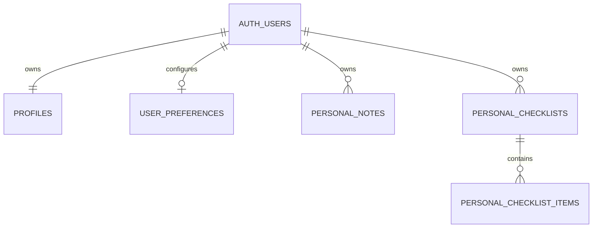

# Phase 2 — สถาปัตยกรรมและแผนพัฒนาฉบับปรับปรุง

สถานะ: **ข้อเสนอเพื่อให้เจ้าของโปรเจกต์ตรวจสอบ**  
ขอบเขตของรอบนี้: แก้ไขเอกสารแผนนี้เท่านั้น ไม่แก้ Frontend ไม่สร้างหรือแก้ไข Supabase Project, Auth, Database, RLS หรือ Edge Function และไม่ Deploy

## 1. สรุปโครงการและข้อเสนอหลัก

### โครงสร้างปัจจุบันที่ตรวจสอบ

ที่ root ของ workspace มีไฟล์เว็บเดิมสามไฟล์:

- `index.html` — โครงหน้าเว็บและ UI ภาษาไทย
- `script.js` — JavaScript ฝั่ง Browser รวม Guided Troubleshooter, คำสั่งเครือข่าย, Checklist, แบบฟอร์ม, Notes และ Saved Cases
- `style.css` — รูปแบบหน้าเว็บและ responsive styles
- `Project 1/` — โฟลเดอร์ว่าง
- `docs/` — เก็บเอกสารแผน รวมถึงไฟล์ฉบับนี้

เว็บเดิมเป็น Vanilla HTML/CSS/JavaScript แบบ Static เผยแพร่บน GitHub Pages ไม่มี package manifest หรือ build system ของ React/Vite ในโครงสร้างที่ตรวจสอบ ฟังก์ชันเดิมบันทึกข้อมูลใน Browser (`localStorage`) และมี JSON Export/Import สำหรับ Saved Cases เท่านั้น

ตามข้อมูลล่าสุด **ไม่มีข้อมูลจริงที่ต้องย้ายจากระบบเดิม** จึงไม่ทำแผน Import Saved Cases เป็น Tickets, ไม่ต้องเพิ่ม Data Migration เพื่อเริ่มระบบ และไม่เปลี่ยนหรือลบข้อมูลเดิม โค้ดและความสามารถเว็บเดิมต้องคงอยู่

### สถาปัตยกรรมที่แนะนำในระยะเริ่มต้น

- พัฒนาต่อจาก HTML/CSS/JavaScript เดิม ไม่ย้ายไป React + TypeScript + Vite ใน Phase 3
- ใช้ Supabase Auth สำหรับ Login/Logout/Session และ Supabase PostgreSQL สำหรับข้อมูลบัญชี/ข้อมูลส่วนตัวที่ Dashboard ต้องใช้
- ใช้ Supabase Publishable/anon key ใน Frontend ได้เฉพาะเมื่อเปิด RLS และกำหนดสิทธิ์ฐานข้อมูลอย่างถูกต้อง; key นี้ไม่ใช่ Secret และไม่ใช่กลไก authorization
- ให้ RLS ใช้ `auth.uid()` จาก Session ที่ Supabase ตรวจสอบแล้วเป็นเจ้าของข้อมูล ห้ามยอมรับ `user_id`, `role` หรือค่า permission จาก request เป็นหลักฐานสิทธิ์
- ระยะแรกใช้บัญชีส่วนตัวหนึ่งบัญชีและข้อมูลส่วนตัวเท่านั้น ไม่สร้างระบบหลายสาขา, Shared IT Data, Ticket CRUD หรือ Asset CRUD
- คงไฟล์ `index.html`, `script.js`, `style.css` เป็นเว็บเดิมที่เปิดทำงานได้ และต่อยอดอย่างเป็นขั้นตอน หากจำเป็นต้องเพิ่มโค้ด/ไฟล์ใหม่ให้ทำโดยไม่เขียนทับของเดิม

GitHub Pages เสิร์ฟ Frontend แบบ Static ได้ แต่ไม่เป็น Backend และไม่สามารถซ่อน Secret ใน JavaScript ที่ส่งไป Browser ได้ Supabase เป็นผู้จัดการ Auth/Database ส่วน RLS เป็นด่านบังคับสิทธิ์จริง ทั้งนี้เว็บ GitHub Pages สาธารณะอาจเปิดหน้า Login ได้ แต่ข้อมูลส่วนตัวต้องไม่อ่านได้ก่อน Login

### เปรียบเทียบ Vanilla กับ React + TypeScript + Vite

| ประเด็น | ต่อด้วย Vanilla เดิม | ย้ายไป React + TypeScript + Vite |
|---|---|---|
| ความซับซ้อนเริ่มต้น | ต่ำ ใช้ไฟล์เดิม เปิด/แก้ได้ตรงไปตรงมา ไม่ต้องเพิ่ม build/dependency | สูงขึ้น ต้องเพิ่ม Node/npm, package manifest, build, routing และตั้งค่า deploy |
| การดูแลรักษา | เหมาะกับขอบเขตส่วนตัวและหน้าจอ Login/Dashboard ที่ยังเล็ก; ต้องจัดระเบียบ DOM/event/state ให้ดีเมื่อฟีเจอร์เพิ่ม | เหมาะเมื่อมีหลายหน้าจอ/ฟอร์ม/สถานะร่วมกันและทีมต้องการ component/type checking; เพิ่มแนวคิดและ tooling ที่ต้องเรียนรู้ |
| ความเสี่ยงต่อเว็บปัจจุบัน | ต่ำกว่า หากเพิ่มโค้ดอย่างเป็นขั้นตอนและคง IDs/ฟังก์ชันเดิม | สูงกว่าในช่วงย้าย: routing/base path/build และการย้ายพฤติกรรมเดิมอาจทำให้ GitHub Pages หรือฟังก์ชันเดิมเสีย |
| ความเหมาะสมตอนนี้ | **แนะนำ** เพราะยังใช้งานส่วนตัวและ Phase 3 มีเพียง Login/Logout/Session/Dashboard | ยังไม่จำเป็น; ประเมินใหม่เมื่อเกิดความซับซ้อนหรือมีหลายผู้พัฒนาที่ต้องใช้ type/component architecture |

ไม่ตัดโอกาสย้าย Framework ในอนาคต แต่ให้ย้ายเมื่อมีเหตุผลจากความซับซ้อนจริง มีแผนรักษาความสามารถเดิม และทดสอบ build/deploy บน GitHub Pages ได้ ไม่ย้ายเพียงเพื่อใช้เทคโนโลยีใหม่

## 2. ขอบเขตข้อมูลและบัญชี

### ระยะเริ่มต้น: Personal Data เท่านั้น

ข้อมูลที่เก็บใน Supabase ต้องเป็นข้อมูลของบัญชีที่ Login อยู่ ได้แก่ Profile, การตั้งค่าบัญชี และข้อมูลส่วนตัวที่อนุมัติให้ซิงก์ในภายหลัง ทุกแถวมีเจ้าของเป็น Supabase Auth user ID และเจ้าของคนอื่นอ่าน/แก้ไขไม่ได้

ใน Phase 3 Dashboard ใช้แสดงสถานะ Login และข้อมูล Profile/สรุปข้อมูลส่วนตัวที่มีจริง ห้ามสร้างตัวเลข Ticket หรือ Asset ตัวอย่างเป็นข้อมูลจริง และไม่ต้องสร้างตาราง Ticket/Asset เพื่อเติม Dashboard ในระยะนี้

ฟังก์ชัน Toolkit ปัจจุบันที่ใช้ `localStorage` ยังคงทำงานใน Browser ตามเดิม ไม่ย้ายหรือซิงก์ข้อมูลเหล่านั้นอัตโนมัติ การเพิ่ม Export เต็มชุด/Import หรือ sync จาก Local Storage เป็นงานแยกที่ต้องได้รับอนุมัติก่อน

### อนาคต: ขอบเขตที่ยังไม่เปิดใช้

Tickets, Assets, Knowledge Base, Checklist ที่แชร์, หลายสาขา, การจัดการบทบาท Admin/IT User และการอ่านข้อมูลร่วมกัน **อยู่นอก Phase 3** หากมีความจำเป็นภายหลัง ต้องออกแบบสิทธิ์และ Schema ใหม่โดยเฉพาะก่อนใช้งานจริง ไม่มี default ที่อนุญาตให้ผู้ใช้ทุกคนเห็นข้อมูลทั้งหมด

## 3. Authentication, Admin Account และ Session

### Login และ Session

- ใช้ Supabase Auth; ปิด Public Sign-up สำหรับระบบส่วนตัว
- ตั้ง redirect URL เฉพาะ URL ที่ใช้งานจริงและ HTTPS; ทดสอบ Login, Logout, session refresh, expiration และการเข้าหน้า Dashboard โดยยังไม่ Login
- Supabase Client อาจเก็บ Session ตามกลไกของ SDK; Session ใช้ยืนยันตัวตนกับ Supabase แต่ค่าจาก Browser ไม่ใช่หลักฐานสิทธิ์ของแถว ข้อมูลทุก request ยังต้องผ่าน RLS
- ไม่เก็บ password เอง ไม่บันทึก access token/refresh token ในไฟล์ Export, log หรือ repository และไม่วาง Service Role Key ใน Frontend
- Logout ต้องล้าง Session ผ่าน Supabase Auth และกลับไปหน้า Login; หากโหลดหน้า protected โดย Session หมดอายุ ต้องไม่แสดงข้อมูลเก่าค้างเป็นข้อมูลที่เชื่อถือได้

### วิธีสร้างบัญชี Admin ในระยะส่วนตัว

คำว่า Admin ในข้อนี้หมายถึงผู้ดูแล Project/บัญชีผ่าน Supabase Dashboard ไม่ใช่ role ที่ Frontend ใช้เปิดสิทธิ์ฐานข้อมูล

| วิธี | ข้อดี | ข้อจำกัด/ความเสี่ยง | เหมาะกับระยะนี้ |
|---|---|---|---|
| สร้าง/เชิญบัญชีจาก Supabase Dashboard และปิด Public Sign-up | ขั้นตอนน้อย ไม่ต้องมี Backend Function หรือ Service Role Key ในเว็บ; Supabase จัดการ Auth | ต้องมีเจ้าของ Project ที่เชื่อถือได้; การจัดการบัญชีทำด้วยมือ; ต้องรักษาสิทธิ์ Supabase Dashboard/MFA | **แนะนำสำหรับเริ่มใช้ส่วนตัว** |
| Edge Function ใช้ Auth Admin API | ซ่อน Admin API/Secret ฝั่ง Server และควบคุม workflow สร้างบัญชีได้ | เพิ่มโค้ดและ Secret ฝั่ง Server; ต้องตรวจ JWT/สิทธิ์ผู้เรียก, ป้องกัน abuse และดูแล/ทดสอบ Function | ยังไม่จำเป็นจนมี workflow สร้างบัญชีให้ผู้ใช้หลายคน |
| สมัครสาธารณะจากหน้าเว็บ | ผู้ใช้สร้างบัญชีเองสะดวก | เปิดช่องทางสมัครและเพิ่มภาระ abuse/provisioning; ไม่ตรงกับการใช้งานส่วนตัวปัจจุบัน | ไม่แนะนำและไม่เปิดใช้ |

ระยะนี้ไม่จำเป็นต้องมีตาราง `roles`, role claim หรือ Edge Function สำหรับสร้างบัญชี เจ้าของสร้าง/เชิญบัญชีผ่าน Supabase Dashboard ก่อน หากต้องมีผู้ใช้คนอื่นในอนาคตให้อนุมัตินโยบายเชิญ/role และออกแบบ server-side operation ใหม่ ห้ามตั้ง role ใน `user_metadata` หรือให้ Client อัปเดต role ของตนเอง

## 4. Schema ที่เสนอสำหรับระยะ Login/Dashboard

Schema ด้านล่างเป็นข้อเสนอเชิงตรรกะ ไม่ใช่ SQL Migration ที่นำไปรันได้ทันที เริ่มจากตารางน้อยที่สุดและเพิ่มเมื่อ Dashboard ต้องใช้ข้อมูลจริง:

| ตาราง | คอลัมน์หลัก | ข้อกำหนด/ความสัมพันธ์ | Index |
|---|---|---|---|
| `profiles` | `user_id uuid PK FK auth.users(id) ON DELETE CASCADE`; `display_name text`; `created_at timestamptz NOT NULL DEFAULT now()`; `updated_at timestamptz NOT NULL DEFAULT now()` | หนึ่งแถวต่อ Auth user; ไม่เก็บ password, Session หรือ role ที่ Client กำหนด; `user_id` สร้างจาก `auth.uid()` เท่านั้น | PK |
| `user_preferences` *(เพิ่มเมื่อมีความต้องการ)* | `user_id uuid PK FK auth.users(id) ON DELETE CASCADE`; `preferences jsonb NOT NULL DEFAULT '{}'`; `updated_at timestamptz NOT NULL DEFAULT now()` | ข้อมูลตั้งค่าส่วนตัวของเจ้าของ; ตรวจ keys/ขนาดและไม่เก็บ Secret | PK |
| `personal_notes` *(เพิ่มเมื่ออนุมัติให้ซิงก์ Notes)* | `id uuid PK DEFAULT gen_random_uuid()`; `user_id uuid NOT NULL FK auth.users(id) ON DELETE CASCADE`; `title text`; `body text NOT NULL`; `created_at`, `updated_at timestamptz NOT NULL DEFAULT now()` | ทุกแถวมีเจ้าของ; ยังไม่ย้าย `quickNotes` เดิมและไม่สร้าง UI CRUD ใน Phase 3 | (`user_id`,`updated_at DESC`) |
| `personal_checklists` *(อนาคตเมื่อบันทึก Checklist บนฐานข้อมูล)* | `id uuid PK DEFAULT gen_random_uuid()`; `user_id uuid NOT NULL FK auth.users(id) ON DELETE CASCADE`; `title text NOT NULL`; `created_at`, `updated_at timestamptz NOT NULL DEFAULT now()` | ตัวอย่าง parent เพื่อออกแบบตารางลูก; ไม่มีใน Phase 3 | (`user_id`,`updated_at DESC`) |
| `personal_checklist_items` *(อนาคตพร้อม parent)* | `id uuid PK DEFAULT gen_random_uuid()`; `checklist_id uuid NOT NULL FK personal_checklists(id) ON DELETE CASCADE`; `position integer NOT NULL CHECK (position >= 0)`; `label text NOT NULL`; `is_done boolean NOT NULL DEFAULT false`; `created_at`, `updated_at timestamptz NOT NULL DEFAULT now()` | สิทธิ์ตรวจผ่าน parent `personal_checklists`; ห้ามเปลี่ยน parent เป็นรายการของผู้ใช้อื่น | Unique (`checklist_id`,`position`); index `checklist_id` |

ไม่มีตาราง `branches`, `departments`, `assets`, `tickets`, `ticket_status_history`, `knowledge_articles`, `tags`, `checklist_templates` หรือ `checklist_runs` ใน Phase 3 เพราะยังไม่อยู่ในขอบเขตใช้งานส่วนตัวและไม่มีข้อมูลจริงให้ย้าย เมื่อจะเพิ่มต้องออกแบบใน Phase แยก

`created_by`/`updated_by` ไม่จำเป็นในตารางส่วนตัวที่ `user_id` ระบุเจ้าของชัดเจน; ถ้าต้องใช้ audit ให้เพิ่มหลังระบุกรณีใช้งานและห้ามเชื่อค่า actor จาก Client โดยตรง ส่วน `updated_at` ตั้งด้วยฐานข้อมูล/trigger ที่ผ่าน review หรือกำหนดจาก logic ที่ตรวจสอบแล้ว

### ความสัมพันธ์



`AUTH_USERS` แทน `auth.users` ซึ่ง Supabase Auth เป็นผู้จัดการ ตาราง Checklist ใน Diagram เป็นแนวทางอนาคต ไม่ใช่ส่วนที่สร้างใน Phase 3

## 5. RLS Design — ป้องกันทุกตารางและตารางลูก

### กติกาพื้นฐาน

1. เปิด RLS บนทุกตารางที่ expose ผ่าน Supabase Data API และเริ่มต้นแบบ deny หากไม่มี policy
2. ตารางข้อมูลส่วนตัวให้เฉพาะ role `authenticated` อ่าน/เขียน โดยตรวจเจ้าของกับ `(select auth.uid())`; ไม่สร้าง policy ให้ role `anon`
3. `user_id` ที่ Client ส่งมาใช้ได้เฉพาะเมื่อ Policy ยืนยันว่าเท่ากับ `auth.uid()` ไม่เชื่อค่าที่ส่งมาเป็นตัวตัดสินสิทธิ์
4. Phase ส่วนตัวนี้ไม่มี `role`/permission field ที่ Frontend ใช้ยกระดับสิทธิ์ หากเพิ่มในอนาคตต้องควบคุมจากช่องทางที่เชื่อถือได้และห้ามเจ้าของแก้ role เอง
5. สำหรับ UPDATE ต้องกำหนดทั้ง `USING` (แถวเดิมที่อ่าน/แก้ได้) และ `WITH CHECK` (แถวใหม่ยังเป็นของผู้ใช้เดิม) เพื่อกันการเปลี่ยน owner
6. ตรวจนโยบาย INSERT/SELECT/UPDATE/DELETE แยกกันบน **ทุกตาราง รวมตารางลูก**; การไม่สร้าง policy สำหรับ operation ใดต้องเป็นการปฏิเสธโดยตั้งใจ ไม่ถือว่า UI ซ่อนปุ่มแล้วเพียงพอ
7. ทดสอบเรียก Supabase API โดยตรง ไม่ใช่ทดสอบเฉพาะ UI

### Policy Matrix ระยะส่วนตัว

| ตาราง | SELECT | INSERT | UPDATE | DELETE |
|---|---|---|---|---|
| `profiles` | `user_id = auth.uid()` | สร้างได้เฉพาะ `user_id = auth.uid()` | แก้ได้เฉพาะแถวตนและแถวใหม่ยังเป็นตน; ป้องกันเปลี่ยน PK/owner | ปิดไว้โดยไม่มี DELETE policy ในระยะแรก; ลบบัญชีผ่านกระบวนการจัดการ Auth ที่อนุมัติ |
| `user_preferences` | เฉพาะแถวตน | `user_id = auth.uid()` | เฉพาะแถวตนและ owner เปลี่ยนไม่ได้ | เฉพาะแถวตน หากผลิตภัณฑ์ต้องรองรับลบการตั้งค่า; มิฉะนั้นปิดด้วยไม่มี policy |
| `personal_notes` | เฉพาะแถวตน | `user_id = auth.uid()` | เฉพาะแถวตนและ owner เปลี่ยนไม่ได้ | เฉพาะแถวตน |
| `personal_checklists` | เฉพาะแถวตน | `user_id = auth.uid()` | เฉพาะแถวตนและ owner เปลี่ยนไม่ได้ | เฉพาะแถวตน |
| `personal_checklist_items` | มี parent checklist ที่ `user_id = auth.uid()` | มี parent checklist ของตน | แถวเดิมและ parent ใหม่ต้องเป็น checklist ของตน | มี parent checklist ของตน |

ช่วง Login/Dashboard อาจสร้างเพียง `profiles` (และตารางที่ Dashboard ต้องใช้จริง) ตารางอนาคตใน Matrix เป็นข้อกำหนดออกแบบล่วงหน้าเท่านั้น ไม่ต้องสร้างทั้งหมดพร้อมกัน

ตัวอย่าง Owner Policy สำหรับตารางข้อมูลส่วนตัวหลัก:

```sql
alter table public.profiles enable row level security;

create policy "owner selects own profile"
on public.profiles for select to authenticated
using (user_id = (select auth.uid()));

create policy "owner inserts own profile"
on public.profiles for insert to authenticated
with check (user_id = (select auth.uid()));

create policy "owner updates own profile"
on public.profiles for update to authenticated
using (user_id = (select auth.uid()))
with check (user_id = (select auth.uid()));

-- Intentionally no profile DELETE policy during initial rollout.

alter table public.user_preferences enable row level security;

create policy "owner selects own preferences"
on public.user_preferences for select to authenticated
using (user_id = (select auth.uid()));

create policy "owner inserts own preferences"
on public.user_preferences for insert to authenticated
with check (user_id = (select auth.uid()));

create policy "owner updates own preferences"
on public.user_preferences for update to authenticated
using (user_id = (select auth.uid()))
with check (user_id = (select auth.uid()));

create policy "owner deletes own preferences"
on public.user_preferences for delete to authenticated
using (user_id = (select auth.uid()));

alter table public.personal_notes enable row level security;

create policy "owner selects own notes"
on public.personal_notes for select to authenticated
using (user_id = (select auth.uid()));

create policy "owner inserts own notes"
on public.personal_notes for insert to authenticated
with check (user_id = (select auth.uid()));

create policy "owner updates own notes"
on public.personal_notes for update to authenticated
using (user_id = (select auth.uid()))
with check (user_id = (select auth.uid()));

create policy "owner deletes own notes"
on public.personal_notes for delete to authenticated
using (user_id = (select auth.uid()));
```

ตารางที่ยังไม่สร้างไม่ต้องนำ SQL ไปใช้ สำหรับทุกตารางที่เปิดใช้จริง ต้องตรวจ PostgreSQL `GRANT` ควบคู่กับ RLS: authenticated ต้องมีเฉพาะสิทธิ์ table operation ที่จำเป็น และ anon ต้องไม่มี table grant สำหรับข้อมูลส่วนตัว การอนุญาตด้วย RLS ไม่สามารถเพิ่ม SQL privilege ที่ไม่มีอยู่ และ SQL grant ไม่สามารถแทน RLS ได้

การห้ามเปลี่ยน `user_id` ของแถวเดิมอาศัย `USING`/`WITH CHECK` เท่านั้นยังไม่ใช่ข้อจำกัดระดับคอลัมน์ที่ชัดที่สุด หากต้องรับประกัน immutable owner ควรจำกัด column-level UPDATE grant ไม่ให้แก้ `user_id` (และให้ UPDATE เฉพาะคอลัมน์ข้อมูล) พร้อมทดสอบการส่ง payload เปลี่ยน owner โดยตรงก่อนใช้งานจริง

### ตัวอย่าง Policy สำหรับ parent/child

ตัวอย่างต่อไปนี้เป็นแนวทางอ่านทบทวน ไม่ใช่ Migration พร้อมใช้ ต้องตรวจชื่อ schema, grants, Supabase version และทดสอบใน Project แยกก่อนใช้งาน:

```sql
-- Parent: personal_checklists
alter table public.personal_checklists enable row level security;

create policy "owner selects personal checklists"
on public.personal_checklists for select to authenticated
using (user_id = (select auth.uid()));

create policy "owner inserts personal checklists"
on public.personal_checklists for insert to authenticated
with check (user_id = (select auth.uid()));

create policy "owner updates personal checklists"
on public.personal_checklists for update to authenticated
using (user_id = (select auth.uid()))
with check (user_id = (select auth.uid()));

create policy "owner deletes personal checklists"
on public.personal_checklists for delete to authenticated
using (user_id = (select auth.uid()));

-- Child: authorization is inherited from its parent row.
alter table public.personal_checklist_items enable row level security;

create policy "owner selects checklist items"
on public.personal_checklist_items for select to authenticated
using (
  exists (
    select 1
    from public.personal_checklists parent
    where parent.id = checklist_id
      and parent.user_id = (select auth.uid())
  )
);

create policy "owner inserts checklist items"
on public.personal_checklist_items for insert to authenticated
with check (
  exists (
    select 1
    from public.personal_checklists parent
    where parent.id = checklist_id
      and parent.user_id = (select auth.uid())
  )
);

create policy "owner updates checklist items"
on public.personal_checklist_items for update to authenticated
using (
  exists (
    select 1
    from public.personal_checklists parent
    where parent.id = checklist_id
      and parent.user_id = (select auth.uid())
  )
)
with check (
  exists (
    select 1
    from public.personal_checklists parent
    where parent.id = checklist_id
      and parent.user_id = (select auth.uid())
  )
);

create policy "owner deletes checklist items"
on public.personal_checklist_items for delete to authenticated
using (
  exists (
    select 1
    from public.personal_checklists parent
    where parent.id = checklist_id
      and parent.user_id = (select auth.uid())
  )
);
```

Policy ของตารางลูกตรวจเจ้าของ parent ในทุก operation รวม UPDATE ทั้งค่าก่อนและหลังแก้ จึงไม่อนุญาตย้ายรายการไป checklist ของผู้ใช้อื่น `ON DELETE CASCADE` ใช้เมื่อเจ้าของลบ parent ที่ตนมีสิทธิ์; ต้องทดสอบพฤติกรรม FK/cascade กับ RLS ใน Supabase ก่อนใช้งานจริง

สำหรับ `profiles`/`user_preferences`/`personal_notes` ให้ใช้เงื่อนไข owner แบบเดียวกันครบทั้งสี่ operation ตาม Matrix ข้างต้น โดยเพิ่ม `USING` และ `WITH CHECK` ให้ UPDATE; กรณีปิด DELETE ให้ไม่สร้าง DELETE policy และเพิกถอนสิทธิ์ SQL ที่ไม่จำเป็น การเปิด RLS อย่างเดียวไม่ทดแทนการตรวจ Table grants

### การใช้ SECURITY DEFINER และ Trigger

- Policy ที่ใช้ `auth.uid()` กับ owner column ไม่จำเป็นต้องมี `SECURITY DEFINER` helper จึงไม่เสนอ helper ในระยะเริ่มต้น
- ไม่ใช้ Trigger สำหรับการกำหนด owner หรือ role จาก Client
- อาจใช้ Trigger ตั้ง `updated_at` หรือสร้าง Profile เมื่อสมัครได้ภายหลัง แต่ต้อง review `search_path`, owner, EXECUTE grants, RLS interaction และการจัดการข้อผิดพลาด; ยังไม่จำเป็นต่อ Phase 3
- ไม่มี `service_role` ใน Browser และไม่มี Edge Function ในสถาปัตยกรรมระยะนี้

## 6. แผนข้อมูลเดิมและ Backup

### Data Migration

- ไม่มีข้อมูลจริงที่ต้องย้ายในโครงการปัจจุบัน จึง **ตัดขั้นตอน Migration จาก Saved Cases เป็น Ticket ออก**
- ไม่สร้าง Import เก่าเป็น Ticket, ไม่อ่าน `localStorage` เพื่ออัปโหลด และไม่เขียนทับ/ลบข้อมูลเดิม
- ไม่จำเป็นต้องเพิ่ม Export เต็มชุดเพื่อเริ่ม Login/Dashboard เพราะไม่มีข้อมูลจริงที่ต้องนำเข้า
- คง JSON Export/Import เดิมของ Saved Cases และพฤติกรรม `localStorage` ตามเดิม; หากอนาคตต้องย้าย/ซิงก์ ให้ขออนุมัติและออกแบบ backup/preview/duplicate handling แยกก่อน

### Backup and Recovery

- ก่อนแก้ Frontend ใน Phase ถัดไป สำรองไฟล์เดิม `index.html`, `script.js`, `style.css` และตรวจว่ามีจุดย้อนกลับที่ใช้งานได้
- หากมีการแก้โปรเจกต์ต้นฉบับจริงภายหลัง ให้ใช้ Git version control/commit ตามกระบวนการของเจ้าของโปรเจกต์ หรือ backup แบบไฟล์ โดยไม่ลบข้อมูลเดิม
- ก่อนใช้งาน Supabase จริง ให้ตรวจสอบ Backup/retention และตัวเลือก restore ของ Supabase plan ที่เลือก; ทดสอบ restore ใน Project ทดสอบ ไม่เขียนทับ Production
- กำหนด RPO/RTO และผู้มีสิทธิ์กู้คืนเมื่อข้อมูลมีความสำคัญต่อการทำงาน; ไม่จำเป็นต้องกำหนดก่อนเริ่ม Phase 3 ส่วนตัวถ้ายังไม่มีข้อมูลธุรกิจ
- ห้ามเก็บ Backup, password, token หรือ Secret ใน repository สาธารณะ

## 7. แผนพัฒนาเป็น Phase

เริ่มแต่ละ Phase หลังเจ้าของอนุมัติขอบเขตของ Phase นั้น รายชื่อไฟล์เป็นแผนเบื้องต้น และต้องตรวจเนื้อหาไฟล์ ณ เวลาลงมือก่อนแก้ทุกครั้ง ไม่มีการลบหรือเขียนทับไฟล์เดิมโดยไม่จำเป็น

### Phase 3 — Login, Logout, Session และ Dashboard

**ขอบเขต:** Auth และ Dashboard ส่วนตัวเท่านั้น; ไม่สร้าง Ticket/Asset CRUD และไม่ sync ข้อมูล localStorage เดิม

**ไฟล์ที่อาจเปลี่ยน/เพิ่ม**

- อาจปรับ `index.html`, `script.js`, `style.css` แบบ surgical เพื่อเพิ่มจุด Login/Dashboard และคง UI/ฟังก์ชันเดิม
- อาจเพิ่ม `supabase-client.js` สำหรับ client configuration และการเรียก Auth/Data API ตาม pattern ที่เลือก
- อาจเพิ่ม `.gitignore` และ `.env.example` เฉพาะเมื่อมีการใช้ environment/build configuration; ไฟล์ตัวอย่างมีแต่ placeholder ไม่มี Secret
- ยังไม่เพิ่ม package manifest หรือย้าย Framework เว้นแต่เจ้าของอนุมัติการเปลี่ยนแนวทาง

**สิ่งที่ต้องทดสอบ**

- Login สำเร็จ/ผิดพลาด, Logout, reload, refresh/หมดอายุ Session, redirect URL และการเข้า Dashboard โดยไม่ Login
- unauthenticated/anon เรียก Data API ไม่ได้
- User A อ่าน/เขียนได้เฉพาะข้อมูล A; User B ไม่อ่าน/แก้ข้อมูล A ได้ แม้แก้ request `user_id`, row ID หรือ payload เอง
- ทดสอบ SELECT/INSERT/UPDATE/DELETE แยกกันทุกตารางที่สร้าง รวมถึงการเปลี่ยน owner และการส่ง `role`/permission ปลอม
- ฟังก์ชันเดิมยังทำงาน: Guided Troubleshooter, คำสั่ง/Copy/Search/Filter, แบบฟอร์ม, Checklist, Notes และ Saved Cases JSON Import/Export
- ตรวจ responsive layout และ Console/Network errors

**เกณฑ์ผ่าน**

- Login/Logout และ Session ทำงานบน GitHub Pages/HTTPS ตาม redirect ที่กำหนด
- RLS ผ่านกรณีเจ้าของ/ผู้ไม่มีสิทธิ์สำหรับทุก operation และไม่มีข้อมูลข้ามบัญชี
- เว็บเดิมและข้อมูลเดิมยังอยู่ ไม่เกิดการอัปโหลด localStorage โดยอัตโนมัติ
- Dashboard แสดงเฉพาะข้อมูลจริงที่เจ้าของมีสิทธิ์อ่าน ไม่ใช้ตัวเลขจำลองเป็นข้อมูลระบบ

### Phase 4 — Personal Data Sync (เฉพาะเมื่ออนุมัติ)

**ขอบเขต:** เลือกข้อมูลส่วนตัวที่จะซิงก์ เช่น Preferences/Notes; ไม่รวม Shared IT Data

**ไฟล์ที่อาจเปลี่ยน/เพิ่ม:** `script.js`, `index.html`, `style.css`, `supabase-client.js`; อาจเพิ่ม Migration SQL และเอกสาร Schema/RLS ในตำแหน่งที่อนุมัติ โดยไม่แตะระบบจริงจนได้รับอนุมัติ

**ทดสอบ/เกณฑ์ผ่าน:** ตรวจ SELECT/INSERT/UPDATE/DELETE และ owner lock; refresh/โหลดหลายอุปกรณ์; แสดง loading/empty/error/success; local data ไม่ถูกเขียนทับ/นำเข้าโดยไม่ยืนยัน

### Phase 5 — Tickets และ Asset Inventory (เมื่อมีความจำเป็น)

**ขอบเขต:** ต้องกำหนดก่อนว่าเป็นส่วนตัวหรือใช้ร่วมกัน ใครอ่าน/แก้/ลบ และมีสาขาหรือไม่; ไม่มี branch/shared schema ที่เปิดใช้งานโดยอัตโนมัติ

**ไฟล์ที่อาจเปลี่ยน/เพิ่ม:** Frontend files ที่เกี่ยวข้อง, Migration SQL, RLS tests และ Schema documentation หลังได้รับอนุมัติ

**ทดสอบ/เกณฑ์ผ่าน:** RLS CRUD, ID enumeration/เปลี่ยน URL, ID Ticket, FK กับ Asset, ประวัติการเปลี่ยนสถานะ, concurrency, export/import (ถ้าอยู่ใน scope) และไม่มีข้อมูลข้ามผู้ใช้

### Phase 6 — Knowledge Base, Checklist และ Reporting (เมื่อมีความจำเป็น)

**ไฟล์ที่อาจเปลี่ยน/เพิ่ม:** Frontend files, Migration SQL/เอกสาร และ test cases ตาม feature ที่อนุมัติ

**ทดสอบ/เกณฑ์ผ่าน:** RLS CRUD ทั้ง parent/child, การเชื่อมโยงข้ามเจ้าของต้องถูกปฏิเสธ, การสร้างรายงานตรงกับข้อมูลจริง, export ไม่มี Auth/Secret และ checklist history ไม่รั่วข้ามผู้ใช้

### Phase 7 — Backup, UX และ Production Readiness

**ไฟล์ที่อาจเปลี่ยน/เพิ่ม:** README/SETUP/DATABASE, GitHub Actions/deploy configuration และเอกสารสำรองข้อมูล เฉพาะส่วนที่เจ้าของอนุมัติ

**ทดสอบ/เกณฑ์ผ่าน:** backup/restore ซ้อมในสภาพแวดล้อมทดสอบ, security/RLS regression, HTTPS/redirect allowlist, build/deploy paths, ไม่มี Secret ใน bundle/log/repository และมีขั้นตอน rollback ที่ทดสอบได้

## 8. แผน Deploy (ยังไม่ดำเนินการ)

### GitHub Pages

1. คง GitHub Pages และเว็บเดิมไว้; ก่อน deploy เวอร์ชันใดให้มีจุดย้อนกลับและตรวจ URL/HTTPS
2. หากใช้ Vanilla JS ต่อ ไม่ต้องเพิ่ม Vite build โดยไม่มีเหตุผล; หากภายหลังเลือก Vite ให้ตั้ง base path ตาม repository และทดสอบ asset/route บน Pages
3. Frontend ใช้เฉพาะ Supabase URL และ Publishable/anon key ที่ออกแบบให้เปิดเผยได้เมื่อ RLS ถูกต้อง
4. ห้ามวาง Service Role Key, Secret key หรือรหัสผ่านใน HTML/JavaScript, GitHub Pages, GitHub Actions artifact, source map หรือ repository

### Supabase (หลังอนุมัติเท่านั้น)

1. สร้าง Project และกำหนดผู้ถือสิทธิ์ Project ก่อนเริ่ม Phase 3
2. ปิด Public Sign-up, สร้าง/เชิญบัญชีส่วนตัวผ่าน Supabase Dashboard และตั้ง redirect URL ให้ตรง GitHub Pages
3. ทบทวน Schema/Grants/RLS; เปิด RLS และทดสอบในสภาพแวดล้อมที่แยกจาก Production ก่อนเก็บข้อมูลจริง
4. ไม่มี Edge Function ในระยะแรก; เพิ่มภายหลังเฉพาะเมื่อมีงานฝั่ง Server ที่ Dashboard/Client ทำอย่างปลอดภัยไม่ได้
5. ตรวจสอบข้อจำกัด Backup และการกู้คืนตาม Plan ก่อนใช้งานข้อมูลสำคัญ

## 9. ความเสี่ยงและแนวทางทดสอบ

| ความเสี่ยง | วิธีลด/ทดสอบ |
|---|---|
| เข้าใจผิดว่า Dashboard ซ่อนข้อมูลแล้วปลอดภัย | ทดสอบเรียก Data API ตรง ๆ ทั้ง anon และ authenticated; ยืนยัน RLS ทุก operation |
| Client ปลอม `user_id` หรือส่ง `role=admin` | ไม่ใช้ role ใน Frontend; Policy owner ผูกกับ `auth.uid()` และลองแก้ payload/row ID |
| Policy ตารางลูกเปิดทางผ่าน parent ที่ไม่ใช่เจ้าของ | ทดสอบ SELECT/INSERT/UPDATE/DELETE child; UPDATE `checklist_id` ข้าม parent ต้องถูกปฏิเสธ |
| Supabase Session หมดอายุแต่ UI แสดงข้อมูลเก่า | ทดสอบ expiry/refresh/logout และเคลียร์ state เมื่อ Session ใช้ไม่ได้ |
| แก้เว็บใหม่กระทบเครื่องมือเดิม | ทดสอบฟังก์ชันเดิมครบและคงไฟล์ต้นฉบับ/ทางย้อนกลับ |
| Supabase key ถูกเข้าใจว่าเป็น Secret หรือเอา Secret ลง bundle | ตรวจ build artifacts/repository; Publishable key ใช้ร่วมกับ RLS เท่านั้น; ไม่มี Service Role Key ใน Frontend |
| เพิ่ม React โดยไม่จำเป็นทำให้ดูแลยาก | คง Vanilla ใน Phase 3; ประเมิน Framework ใหม่เมื่อเกิดความซับซ้อนที่วัดได้ |
| เปิดสมัครโดยไม่ตั้งใจ | ปิด Public Sign-up ใน Supabase และทดสอบ signup จาก Client ถูกปฏิเสธ |

## 10. การตัดสินใจที่ต้องยืนยันก่อน Phase 3

1. อนุมัติให้คง Vanilla HTML/CSS/JavaScript ต่อใน Phase 3 และยังไม่ย้าย React/Vite หรือไม่
2. อนุมัติใช้ Supabase Auth สำหรับบัญชีส่วนตัวหนึ่งบัญชี และสร้าง/เชิญบัญชีผ่าน Supabase Dashboard โดยปิด Public Sign-up หรือไม่
3. Dashboard ระยะแรกควรแสดงอะไรจากข้อมูลจริงบ้าง เช่น สถานะบัญชี/ข้อมูล Profile เท่านั้นหรือมีข้อมูลส่วนตัวที่ต้องซิงก์ด้วย
4. อนุมัติให้ความสามารถเดิมที่เก็บใน `localStorage` คงทำงานแบบ local-only โดยไม่ sync ไป Supabase ใน Phase 3 หรือไม่
5. ใครเป็นเจ้าของ Supabase Project และเป็นผู้รักษาสิทธิ์ Dashboard/MFA? ต้องกำหนด MFA/นโยบายรหัสผ่านเพิ่มเติมหรือไม่
6. ใน Phase 3 ยอมให้แก้เฉพาะไฟล์ Frontend ที่จำเป็นเพื่อ Login/Dashboard โดยรักษาไฟล์/พฤติกรรมเดิม และเพิ่มไฟล์ client/config เท่าที่จำเป็นหรือไม่

## สรุป

1. **สถาปัตยกรรมแนะนำ:** ต่อจาก Vanilla HTML/CSS/JavaScript เดิมบน GitHub Pages เชื่อม Supabase Auth และ PostgreSQL/RLS; เหมาะกับขอบเขตส่วนตัวและ Login/Dashboard ที่เล็กกว่า โดยหลีกเลี่ยงความซับซ้อนของการย้าย Framework ในตอนนี้
2. **การตั้งค่าด้วยตนเองหลังอนุมัติ:** สร้าง Supabase Project, สร้าง/เชิญบัญชีผ่าน Dashboard, ปิด Public Sign-up, ตั้ง redirect URL/HTTPS/MFA ตามที่เลือก และกำหนด Backup เมื่อมีข้อมูลสำคัญ
3. **ความเสี่ยงหลัก:** RLS ผิดพลาด, Client ปลอม owner/role, Session หมดอายุ, การเปลี่ยนเว็บกระทบฟังก์ชันเดิม และการเปิดเผย Secret; ลดด้วย RLS default-deny และทดสอบ Data API/ตารางลูกทุก operation
4. **ก่อนเริ่มพัฒนาระบบจริง:** ขอคำยืนยันข้อ 1–6 ข้างต้น จากนั้นเริ่ม Phase 3 โดยเปลี่ยนเฉพาะไฟล์ที่จำเป็น ไม่ทำ Migration จาก Saved Cases และไม่สร้าง Ticket/Asset CRUD

ไม่มีการแก้ไข Frontend เดิม สร้างหรือแก้ไข Supabase Project/Database/Auth/RLS/Edge Function หรือ Deploy ในรอบการปรับปรุงแผนนี้
